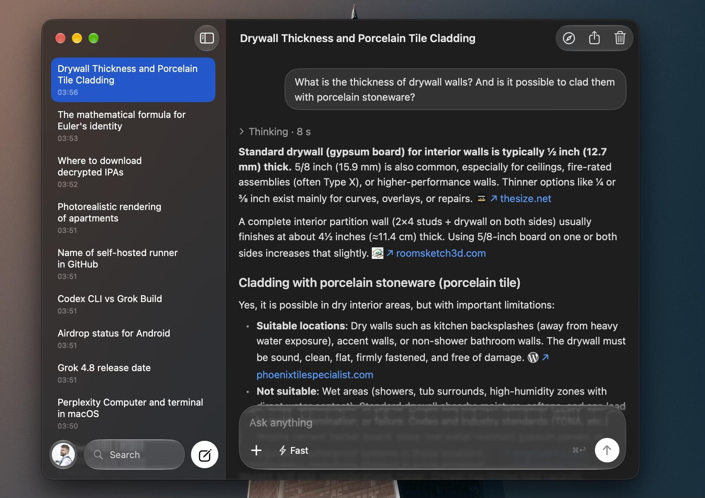
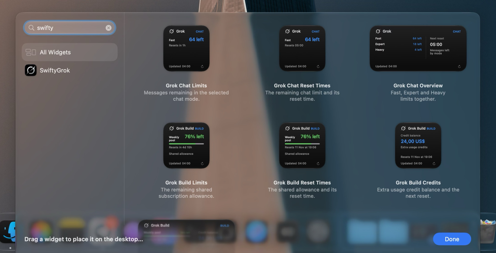
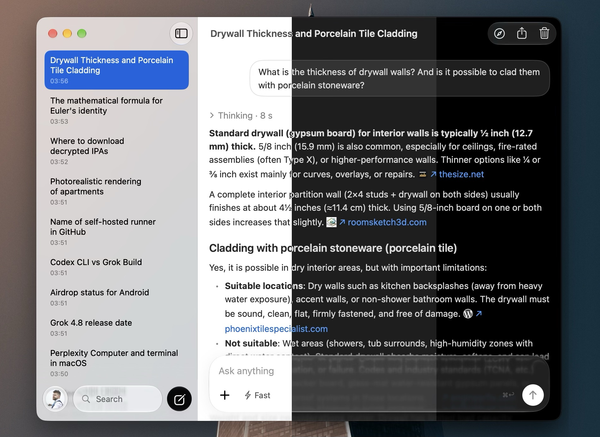
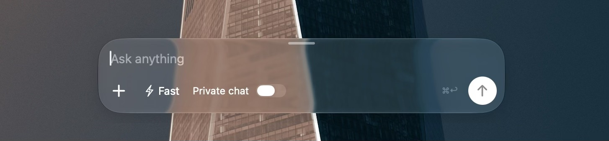
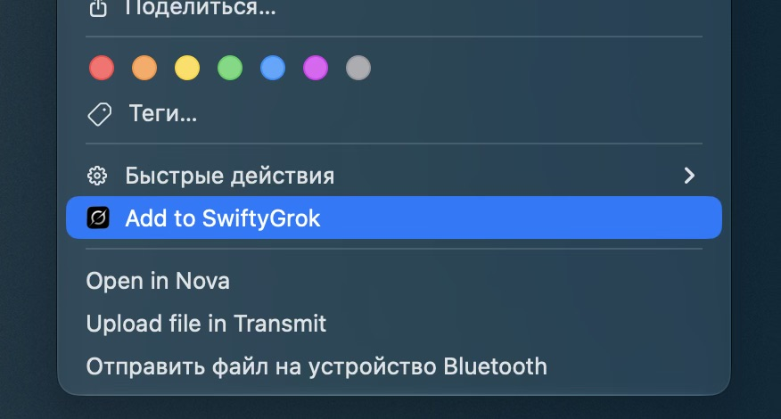

# SwiftyGrok[^vibe]

A native, unofficial **Grok client for macOS 14+ on Apple Silicon**. Sign in with your existing Grok account and keep your chats, desktop widgets, and floating chat bar close at hand.

**SwiftyGrok is an independent project and is not affiliated with, endorsed by, or sponsored by Grok or SpaceXSI.**

## Features

### Grok on your Mac

Your Grok conversations in a native Mac app, with Liquid Glass controls and familiar macOS behavior. Sign in with the Grok account you already use; **no API key is required**.



### Limits on your desktop

Add compact widgets or a wider overview to your desktop to check chat limits, Grok Build's shared allowance, reset times, and extra usage credits at a glance.



### A theme for your setup

Choose **Light**, **Dark**, or **Black**, or let **Auto** follow your Mac's appearance. The chat window and floating bar adapt together, and you can adjust the bar's transparency to suit your desktop.



### A chat bar, wherever you're working

Press **⌥Space** from another app to bring up the floating chat bar. Write a question, attach a file, and choose a response mode; sending opens a new chat in SwiftyGrok. Drag the bar to a comfortable spot and it remembers its position.



### Files straight from Finder

Right-click a file in Finder and choose **Add to SwiftyGrok**. It will be attached to your open chat, or to a new chat if none is selected, ready for your next message.



## Build and run

Requirements: **Xcode 16+** with Command Line Tools selected, and macOS Sonoma 14 or later on Apple Silicon. Native Liquid Glass is used on supported versions of macOS, with a material fallback on older systems.

Open `SwiftyGrok.xcodeproj`, choose the **SwiftyGrok** scheme and **My Mac**, then press **⌘R**. Local builds use ad-hoc signing and do not require a paid Apple Developer account.

To build a standalone app:

```bash
cd SwiftyGrok
bash Scripts/build-app.sh
open build/SwiftyGrok.app
```

The script runs the tests, builds an Apple Silicon-only Release app for arm64, verifies that all three executables contain only arm64, checks them for local build paths and source/object debug records, and validates their signatures. Xcode strips non-global symbols before signing; separate dSYM files remain in the ignored Xcode build directory for local crash analysis and are not packaged in the app. The finished app is `build/SwiftyGrok.app`, alongside the SwiftPM and Xcode build directories. You can move it to `~/Applications` or `/Applications`.[^gatekeeper] Distribution to other users requires your own Developer ID signature and notarization; this script is intended for local builds.

You can also open `Package.swift` in Xcode or run `swift run --arch arm64 --scratch-path build/swiftpm SwiftyGrok`. Use the Xcode project to produce a complete app bundle with its icon.

## Sign in

1. Sign in to **grok.com** in the app's browser window.
2. Complete browser verification if requested.
3. Click **Connect session**. SwiftyGrok checks the cookies against the history endpoint before opening your chats.

On subsequent launches, the saved session is loaded from macOS Keychain and checked again. **Sign out** removes it from Keychain and clears the app's browser session. The embedded browser uses a nonpersistent WebKit data store. Passwords are handled by the Grok sign-in page; SwiftyGrok does not read them.

## Keyboard shortcuts

| Shortcut | Action |
| --- | --- |
| ⌥Space | Show or hide quick input when the main window is not focused |
| ⌘, | Open Settings |
| ⌘N | Start a new chat and open the main window |
| ⌘F | Focus chat search and show the sidebar if hidden |
| ⌘↩ | Send a message by default; insert a new line in the alternate mode |
| ⌘R | Refresh the current chat |
| ⇧⌘R | Refresh history |
| Delete / Forward Delete | Open delete confirmation for the selected chat while history is visible |
| Enter | Open rename for the selected chat while history is visible; insert a new line in the editor by default, or send in the alternate mode |

The send shortcut is handled only in the message editor, including quick input; IME candidate confirmation is preserved. Holding the send key does not send repeated messages or stop a response.

History shortcuts leave text fields, the message editor, menus, and dialogs unchanged. They are disabled when the sidebar is hidden or there is no selected chat in the visible history list.

## Behavior and limitations

SwiftyGrok uses an unofficial web API. Grok may change its endpoints, response formats, account restrictions, or verification requirements. Matching cookies and User-Agent values does not guarantee that `URLSession` requests will be accepted. The app reports authorization and verification errors and lets you reconnect; it does not bypass browser verification.

After sending, the client reloads the message thread to reconcile server IDs before another reply. After cancellation, a network failure, or an incomplete thread, sending is blocked until the chat is refreshed. Requests are not automatically resubmitted because the server may already have saved the message. Stopping the client stream does not guarantee that server-side generation stops.

History, messages, and drafts are kept in process memory, without an offline cache. Initial loading requires a network connection. A dedicated image-generation mode, voice features, subscription management, and offline mode are not implemented.

## Development

SwiftyGrok is built with SwiftUI, AppKit, and WebKit. It uses the vendored [swift-grok](https://github.com/0xSMW/swift-grok) client and [SwiftMath](https://github.com/mgriebling/SwiftMath) for native math rendering. The required dependency sources and math fonts are included in the repository.

```text
Sources/SwiftyGrok/    SwiftUI views, AppKit integration, WebKit sign-in, Keychain
Sources/GrokCore/      API adapter, chat state, message parsing, RU/EN resources
Sources/GrokUsage/     Display snapshots, Build billing, widget localization
Sources/SwiftyGrokWidgets/ WidgetKit extension with seven usage widgets
Vendor/swift-grok/     Vendored GrokClient and MIT license
Vendor/SwiftMath/      Vendored native math renderer and fonts
Tests/                State, protocol, rendering, and credentials tests
Configuration/        Info.plist and app icon assets
SwiftyGrok.xcodeproj/  Xcode app target with local package dependencies
Scripts/build-app.sh  Test, build, and package the app
```

After adding Swift files to `Sources/SwiftyGrok`, add them to the SwiftyGrok target in Xcode. The checked-in Xcode project is used directly; no project generator is required.

To run the checks separately:

```bash
swift test --arch arm64 --scratch-path build/swiftpm
xcodebuild -project SwiftyGrok.xcodeproj -scheme SwiftyGrok \
  -destination 'generic/platform=macOS' -derivedDataPath build/xcode \
  ARCHS=arm64 ONLY_ACTIVE_ARCH=NO CODE_SIGN_IDENTITY=- build
```

Build artifacts are kept under a single `build/` directory: `build/swiftpm` for SwiftPM and `build/xcode` for Xcode. Running plain `swift test` or `swift run` without `--scratch-path` will use SwiftPM's default `.build` directory instead. App icon sources are PNGs in `Configuration/Assets.xcassets`; Xcode generates the packaged ICNS automatically.

The core and vendored GrokClient can also be built and tested on Linux.

Local verification includes the core tests, an arm64 Release build, and signature validation. Network mutations are tested with local HTTP fixtures rather than changing real account chats.

## Contributing

Contributions and pull requests of any size are welcome. I'd appreciate any commits that help bring SwiftyGrok's functionality as close as possible to the official Grok web app.

## License and credits

The project is licensed under MIT. GrokClient is © 2025 Klu, Inc.; vendored licenses and revisions are retained in the repository. See [THIRD_PARTY_NOTICES.md](THIRD_PARTY_NOTICES.md) for dependencies, modifications, and artwork provenance. Grok artwork belongs to xAI and is not covered by this project's MIT license.

[^vibe]: This project is fully vibe-coded, from development to publication.

[^gatekeeper]: Release builds use ad-hoc signing and are not notarized by Apple. macOS may show a Gatekeeper warning when you first open the downloaded app.
